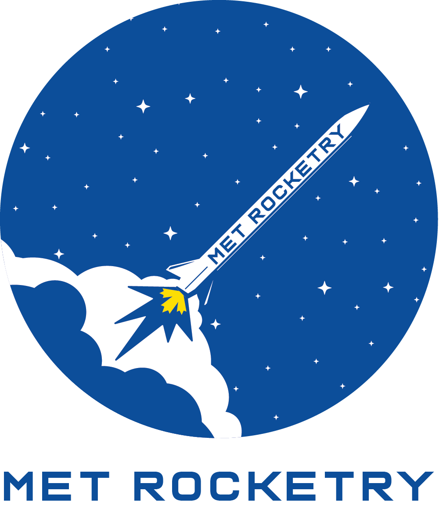
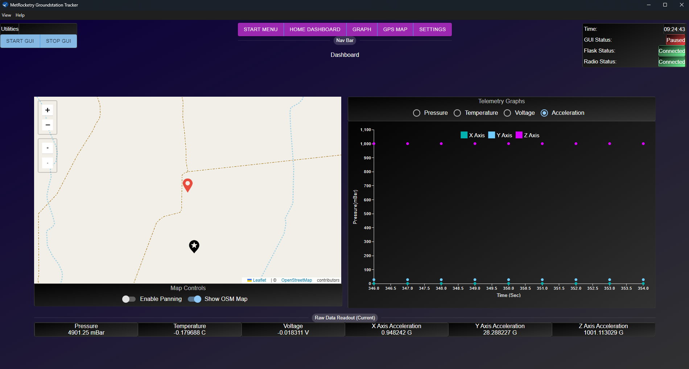

  

  <h3 align="center">Ground Station GUI Application</h3>

  

    Desktop application that provides visual telemetry data transmitted from MetRocketry's Rockets during launch. 
     
    <a href="https://github.com/Ryerson-Rocketry/Groundstation-GUI/tree/main/_Documentation"><strong>Explore the docs (TBD) »</strong></a>
     
    <a href="https://github.com/Ryerson-Rocketry/Groundstation-GUI/issues">Report Bug</a>
  

### Overview 
This GUI aims to convert the Pyside6 based ground station SRAD GUI used from 2023-2024 into an Electron based GUI from 2025 onwards due to the ease of development.

# About This Project

 V1.01 Dashboard Demo  

# Overview
This project is a Student Student Researched & Developed (SRAD) GUI that receives telemetry data transmitted from a given rocket before formatting and displaying it to the user. This is done by monitoring a serial port with a radio connected and parsing the data sent in from this serial port (as a comma separated string). This data gets filtered and stored in a internal flask server on the backend. The frontend Electron program will then periodically requests this data and render it.

# Built With

### Tech Stack
*  - Framework
	*  - Frontend Library/Framework
		*  - Frontend UI Library
		*   - Mapping Library
	*  - Backend Framework (Main)
	*  - Backend Framework (Radio)	  

# Getting Started

### Installation

Production Build (Note: Windows only) - Available in “Releases” on the right sidebar in the repository:

1. Download and extract Zip file from the latest release
2. Start GUI by opening **gsGUI.exe** file

### Setup (With Radio)

To Run the GUI once opened:

1. (Radio Setup) Connect a radio receiver to any serial port on your computer
    1. Find the serial port name that the device is connected to (via Device Manager)
    2. Enter the number of the port on the top left panel in the GUI (ex 4 if port id is COM4)
    3. Click the radio connection button, if “Radio Status:” on the top right status panel shows “connected” for more than 2-3 seconds then setup is correct
    4. **Note:** the radio should be configured to output comma separated values [specified in this repo](https://github.com/Ryerson-Rocketry/Library-RRC-encoder)
2. Enter the latitude and longitude of expected initial launch point of rocket (will be used as the starting camera location and map marker on the gps map)
3. Click “Enter Dashboard”

**If GUI is to be used offline:**
4. Within the map shown on the left in the dashboard, press the bottommost "+" button on the top left to save the map tiles near the currently zoomed in location. This will save them locally for use if host laptop/computer has no WIFI/data.

### Demo Setup (Without radio as well as pre-set Demo data)

- Simply press “Demo Mode” and “Click Enter Dashboard”
	- Demo data automatically included within the installation

### Development Installation

TBD

### Languages:
- Python
- JavaScript/Typescript

# Attributions 

### Graphics:
- Map:
	- <a href="https://www.flaticon.com/free-icons/location" title="location icons">Location icons created by IconMarketPK - Flaticon</a> 
	- <a href="https://www.flaticon.com/free-icons/address-location" title="address location icons">Address location icons created by alkhalifi design - Flaticon</a>